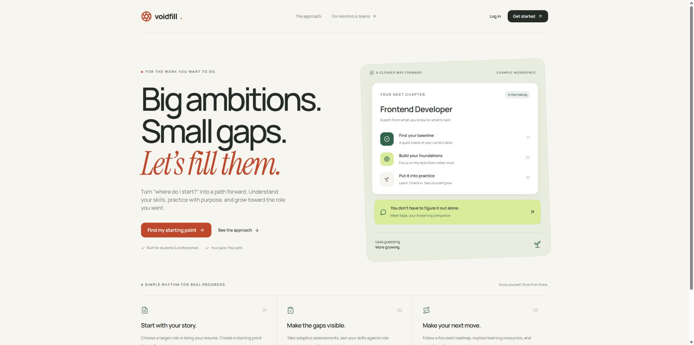

# Accessibility engineering follow-up — 10 November 2026

This is a source review and repair record, with one fresh public landing-page
baseline. It is **not a completed rendered-flow accessibility audit**. Human
participant validation and practitioner review are explicitly deferred by the
owner. Spoken screen-reader behavior is unverified.

## Capture and browser boundary

The Chrome extension for Person 1 opened the live `f8ffd92` release through the
normal public origin. The exact landing screenshot was saved, reopened and
inspected. Its source copy has the same SHA-256 as the private original; it
contains no learner data or authentication details.

Tab-level `Ctrl+=` did not change the measured DPR or viewport width, so it is
not evidence of browser zoom. Selecting Chrome's native window to access its
real zoom controls returned this exact safety stop:

> Computer Use has been stopped for this turn because it could not determine the current browser URL on Windows with enough confidence to enforce policy. Stop your work and send a final message noting why Computer Use ended.

All UI interaction stopped at that point and the CUA completion summary was
recorded. No alternate route was used to evade the stop. No demo, real learner
session, password/MFA action, OS preference change or software installation was
performed during this capture. The review then continued in source only.

## Source findings and repairs

| Step | Task and source finding | Implemented engineering change | Actual rendered status |
| --- | --- | --- | --- |
| 1 | Reach the public entry at narrow/text-zoomed sizes. The small-screen navigation had a fixed height and the headline a fixed 64px size. | Navigation can wrap and grow; the headline uses a bounded responsive size and permits long words to wrap. | Normal-size baseline captured. Narrow/reflow/zoom repair pending Chrome verification. |
| 2 | Open mobile navigation, then return to desktop width. The modal flag, body scroll lock and inert workspace could survive after the mobile close control became hidden. | A desktop media-query change closes the drawer; cleanup restores focus to visible navigation or main content. Its pointer-dismiss backdrop remains usable. | Pending Chrome resize, Escape, backdrop and keyboard checks. |
| 3 | Work inside a modal. The trap omitted textareas/summaries and did not make background content inert. Independently restored scroll states could conflict between overlapping dialogs. | Shared modal leases isolate ancestor siblings, preserve prior inert/scroll states, assign keyboard ownership to the top dialog and release safely out of order. Candidate filtering includes native controls and one tab stop per radio group; boundary wrapping also recovers outside focus. | Eight controlled-model unit tests pass. Native DOM/AT behavior remains pending. |
| 4 | Use the expanded atlas on a short zoomed viewport. A fixed-height fullscreen container, nonshrinking dock and 240px map could place actions below an unscrollable screen. Map keys also consumed modified browser-zoom chords. | Expanded atlas is a labelled modal with internal vertical scrolling and a usable map minimum. Bare map shortcuts remain; Ctrl/Meta/Alt keyboard chords are left to the browser. Focus restoration avoids content isolated by a newer dialog. | Pending real zoom, scroll, nested-resource-sheet and keyboard checks. |
| 5 | Read long learning/resource text and practical controls. Fixed dock title ellipsis and minimum grid content widths could conceal useful text or force overflow. | Dock titles wrap, small action grids can shrink/stack, long form/question content wraps, and practical filters can wrap. The two-dimensional map retains its separate pan/zoom interaction and list alternative. | Pending 320 CSS-pixel, long-label and large-text checks. |
| 6 | Use the app with reduced motion. The CSS override alone could not govern Framer Motion's JavaScript transforms and progress springs. | Workspace motion uses the user's reduced-motion preference; the progress component removes its spring when that preference is active. Existing CSS transition/motion overrides remain. | Source/type checks passed; actual preference/render verification pending. |
| 7 | Identify focus, selected answers and map state with forced colors. Custom visually hidden radios and decorative colors lacked explicit treatment. | Forced-color rules expose native answer radios, retain system-color focus/selection boundaries, remove the bitmap map background and use system strokes for map state. Decorative answer-letter/check badges are hidden from accessible names. | Source/type checks passed; actual forced-color rendering and speech pending. |
| 8 | Upload, review, save or clear a resume using a keyboard. Result arrival had no explicit focus, evidence was presented as hover-only, and writable controls could race a pending profile save. | Explicit user-action focus intents target the result heading, error, saved status or upload control. Each skill checkbox describes its evidence. Pending ref guards/disabled controls prevent overlapping upload/save/clear actions; edits clear stale success without moving focus. Invalid replacement files retain the prior extraction. Unknown DOCX pagination is labelled unavailable instead of claiming one page. | Pending synthetic Chrome checks. No real profile Apply has been performed. |

## Verification performed

- `node --import tsx --test tests/focus-management.test.ts`: **8 passed**.
- `npx tsc --noEmit`: passed.
- `npm run lint`: passed without warnings after the ref-cleanup repair.
- `git diff --check`: passed for the edited files.

The focus tests use a controlled document model. They cover ancestor-sibling
isolation, preservation of existing inert state, nested/overlapping modal
ownership, out-of-order/idempotent cleanup, scroll restoration, dedicated
pointer-dismiss behavior, filtering, radio grouping and boundary cycling. They
do not execute Chrome, validate CSS layout, reproduce native selector/Tab
semantics or establish screen-reader speech. No Playwright CLI/MCP or axe was run.

## Chrome verification on 11 November

The connected Chrome profile exercised the production build on a disposable Data Analyst workspace.

1. **Resume reflow.** Chrome reported a 320 CSS pixel window and equal 306 pixel document and client widths. The upload control and information panel remained readable. [Resume layout](assets/accessibility-depth-20261110/02-resume-reflow.jpg)
2. **DOCX review.** Uploading the fictional structured document moved focus to the review heading. The page reported unavailable pagination and linked a skill checkbox to its evidence description. [DOCX review](assets/accessibility-depth-20261110/03-docx-review-focus.jpg)
3. **Mobile navigation.** Opening the drawer focused Close navigation and isolated the workspace. Shift+Tab wrapped from the first link to Sign out. Escape restored focus and scrolling. Switching to desktop width while the drawer was open removed the dialog, inert state and scroll lock. [Mobile drawer](assets/accessibility-depth-20261110/04-mobile-navigation.jpg)
4. **Atlas and assessment.** The expanded atlas showed three Python lessons and opened the resource sheet. The Pandas correction loaded and expanded. The data structures lesson presented three questions. At 320 CSS pixels the quiz fit its viewport, isolated the roadmap controls, and focused the next question heading. Escape paused it. Reload restored question two, and keyboard navigation back to question one showed the retained answer. [Expanded atlas](assets/accessibility-depth-20261110/05-learning-atlas.jpg) · [Lesson assessment](assets/accessibility-depth-20261110/06-lesson-assessment-reflow.jpg)
5. **Replacement and save recovery.** The first Chrome run exposed a cleared extraction after a rejected PDF. The rebuilt app kept the DOCX and the edited two-skill selection, then focused the error. Applying the fictional selection focused the save status. Clearing the extraction returned focus to Upload resume. [Replacement recovery](assets/accessibility-depth-20261110/07-resume-replacement-recovery.jpg)

The screenshots were reopened and inspected. The temporary viewport was reset and the disposable test tab closed. Chrome's keyboard zoom chord did not change the measured viewport or device pixel ratio in this session. Actual 200% and 400% browser zoom, forced colors, reduced motion, and long-label practical studio scenarios still need rendered checks. Participant feedback and spoken screen-reader output remain deferred.

## Practical Studio retest on 12 November

At 320 CSS pixels, Chrome truncated the longest activity name in the native
selector. The controls now show the full selected activity in the note below
them. In a disposable learner workspace, Chrome displayed the full Learning &
Development Coordinator name, moved keyboard focus from Your activity to
Learning stage, and measured a document width equal to the 306-pixel client
width. The app's viewport was 320 CSS pixels. The release record has the
production verification. [Practical Studio change](https://github.com/Zsw0rd/VoidFill/pull/13)
