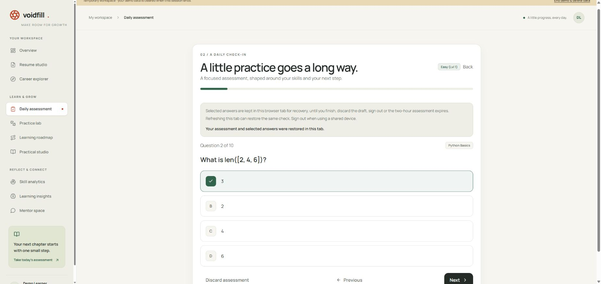
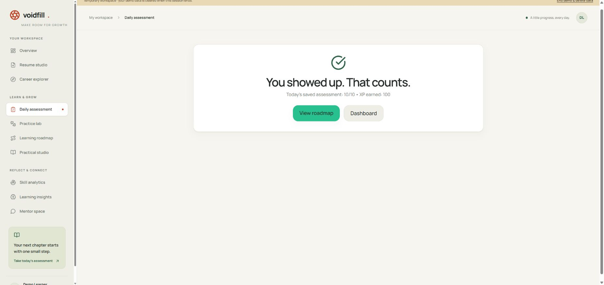
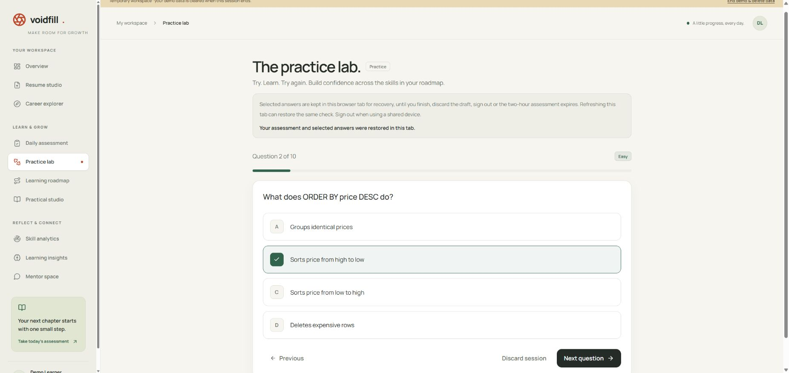
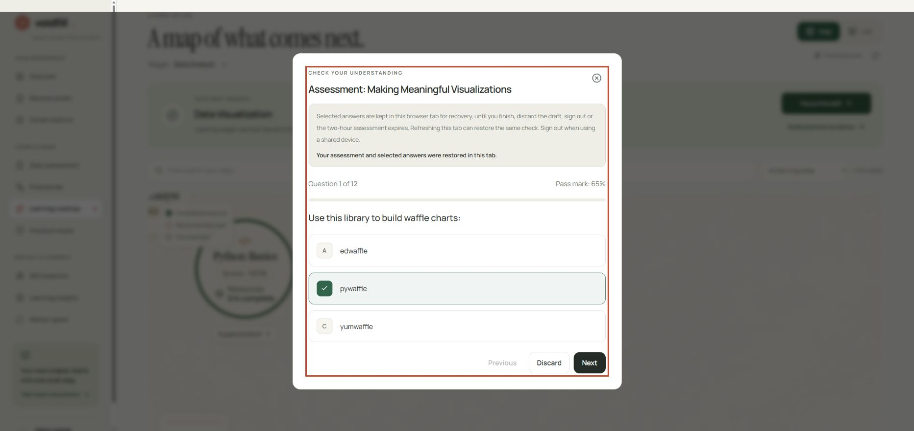
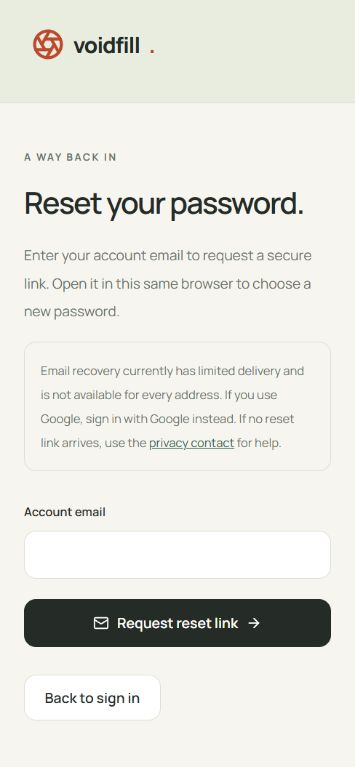
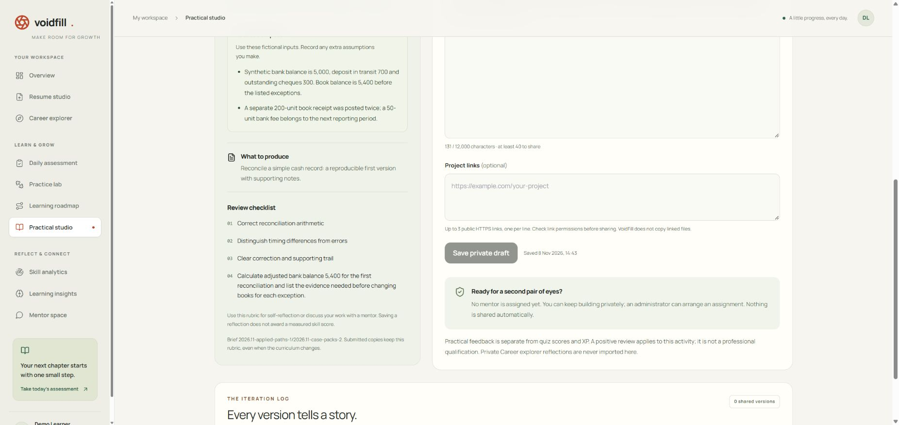
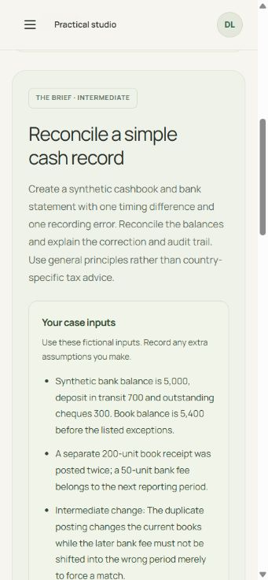
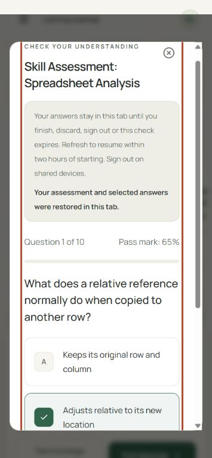
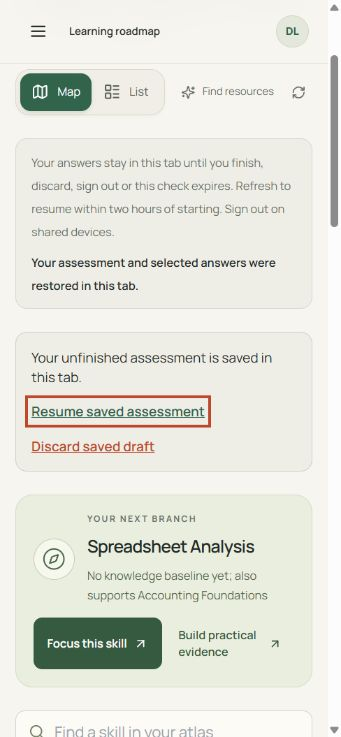

# Account controls, recoverable assessments and deeper career practice

This follow-up retains the existing Vercel/Supabase learning runtime and float32
ONNX model. Sage/Gemini, its long-conversation behavior, backup arrangements,
existing account roles and earned progress are unchanged. The release pull
request records hosted checks, publication identifiers and post-deployment results.

## Resulting behavior

Assessment refreshes now restore the original sealed check, answer selections
and question position in the same tab. Restore requires the same authenticated
owner, purpose, current learning direction and unexpired token. Server grading,
submission identity and two-hour expiry are unchanged. Drafts are cleared on
normal completion, discard or sign-out; malformed/expired/mismatched storage is
rejected. Nothing syncs a draft to a second device.

Account & privacy provides an own-data application export and a recorded,
cancellable deletion request. Administrators have an inbox with pagination and
visible review status. A request, cancellation or closed review does not erase
an account. Actual erasure remains a separate identity/ownership review. Password
recovery requires a provider-validated token with a recent recovery AMR plus an
HttpOnly signed grant bound to that exact user/session.

All 960 foundation-extension option sets have authored task-related alternatives.
Longest-correct frequency changes from 79.9% to 38.0%; uniquely shortest is 31.6%.
Both tails are recorded, not just the favorable statistic. Residual style cues
remain. Every career has a synthetic case pack with separate foundation and
intermediate tasks and objective checks, copied into saved practical briefs.
Existing briefs retain their original versions and inputs.

Weights, tokenizer, pooling, question identities/order, role requirements and
earlier grading remain intact. The actual FP32 index rebuild was bit-identical;
source-content fingerprints bind the revised options and cases. This is agent
editorial/engineering review, not specialist approval or learner calibration.

## Chrome evidence

The owner selected Chrome-only UI checks. No Playwright CLI or axe suite was
executed. The following use disposable synthetic accounts; no private entry key,
real account email, credential or private learner evidence is in these images.

- Daily and practice reloads retained the selected options and question position.
  The recovered daily check saved 10/10 and 100 XP; another reload displayed that
  same saved result. The guidance shown in these initial proof
  images was subsequently shortened for phone layouts.
- Course and skill assessment reloads restored their own original questions and
  selected options. Discard followed by reload returned to a fresh practice page.
- At 355 CSS pixels, inspected pages had no horizontal document overflow and
  one main landmark. The recovery email input retained its accessible name;
  an ordinary session without a recovery grant showed no new-password form.
- A restored roadmap dialog initially returned keyboard focus to the page body.
  After repair, Escape focuses **Resume saved assessment**; Enter reopens the
  same selected answer. The temporary viewport override was reset afterward.
- The first saved demo practical brief dropped the new case inputs after reload.
  Its Python snapshot builder now includes the same version, inputs and extra
  verification criterion as the application builder. Fresh save/reload retained
  the case and synthetic draft text. Tests cover future catalogue changes and
  mentor snapshot copies, not just the initial editor preview.
- Temporary test sessions ended through the normal demo control. Tests did not
  send recovery mail, change real passwords, request a real account deletion,
  grant staff access or erase real accounts.

## Validation and operational boundaries

The three CI groups remain required. Application tests include draft ownership,
expiry, malformed storage, recovery authorization and export isolation. The
database job tests the additive account-request migration, owner/admin RLS,
stale review IDs and repeatable upgrades on disposable PostgreSQL. The model job
includes the new editorial tests and practical snapshots. HTTP acceptance checks
all four resume purposes, sealed grading/replay, account boundaries and all 60
careers at both learning levels. Browser regressions remain manual opt-in,
disabled by default under the owner's Chrome-only choice.

Local load diagnostics support sixteen demo clients and a bounded paced run;
production caps are unchanged. Their actual counts, successful/failed requests,
latencies, deliberate pacing and cleanup totals are recorded in the release PR.
They are synthetic local evidence, not hosted real-user capacity or a latency SLA.
No load is generated from CI against real accounts.

Chrome confirmed the production site and existing three callback allowlist
entries, including the callback path used for recovery. No OAuth/redirect scope
was expanded. The project still uses Supabase's built-in email service, whose
recipient/rate restrictions prevent claiming public password-reset delivery.
No SMTP provider or paid plan was added. Existing cached-egress usage is above
the free allowance; build-cache verification and batched publication reduce
additional artifact downloads but cannot undo past metered usage.

The [learner pilot protocol](LEARNER_PILOT.md) is ready for consenting participants.
No human participant study, actual screen-reader speech session, professional
validation or general-public recovery email delivery is claimed. The hard
two-hour expiry is covered by server tests; Chrome did not wait two hours.

See [project status](PROJECT_STATUS.md), [account controls](ACCOUNT_SELF_SERVICE.md),
[assessment recovery](ASSESSMENT_RECOVERY.md),
[foundation editorial evidence](FOUNDATION_EDITORIAL.md),
[all career case packs](CAREER_CASE_PACKS.md), and
[performance methods](PERFORMANCE_VALIDATION.md).
