# Usability and accessibility validation

This audit follows the existing VoidFill design and checks representative tasks,
not a new visual direction. The baseline was captured on 7 November 2026 through
Chrome against a production-mode loopback application. Every screenshot below was
saved and opened before acceptance. One premature loading screenshot was rejected
and replaced with the loaded atlas. All published screenshots use synthetic demo
data; real-account acceptance and notification-setting evidence remains private.

## Scope and limits

The goal is to choose a direction, understand the next learning step, take a
knowledge check, prepare private practical work and navigate using a keyboard or
narrow screen. The baseline learner persona is an Accounting Associate. Technical
assessment context and the mentor review desk are checked separately.

The user selected Chrome-only checks. No Playwright CLI or axe scan was run for
this validation; the temporary axe dependency and unrun test were removed. The
existing optional automation is separate evidence and must not be described as
having run for this release. There were no recruited participants, domain experts
or actual screen-reader speech sessions. This is an agent-led journey/DOM audit,
not a human usability study or WCAG conformance claim.

## Captured baseline journey

1. **Public entry — clear.** The primary starting action, login and mentor entry
   are visible. The illustration is explicitly labelled as an example workspace.
   Contrast and assistive-technology behavior require separate inspection.

   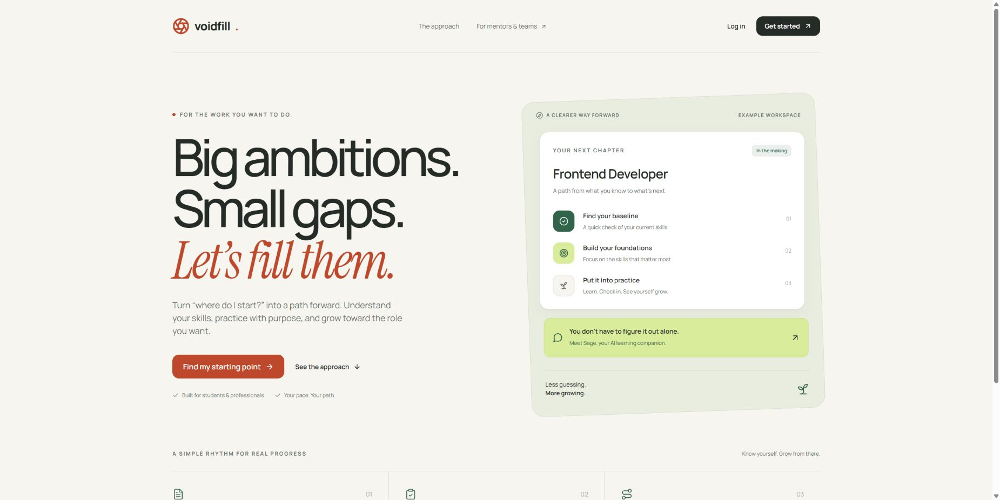

2. **Resume entry — clear.** Accepted formats, file limits, extraction/review
   sequence and retention boundary are visible. Imported claims are clearly
   separated from measured scores. No real resume was uploaded in this audit.

   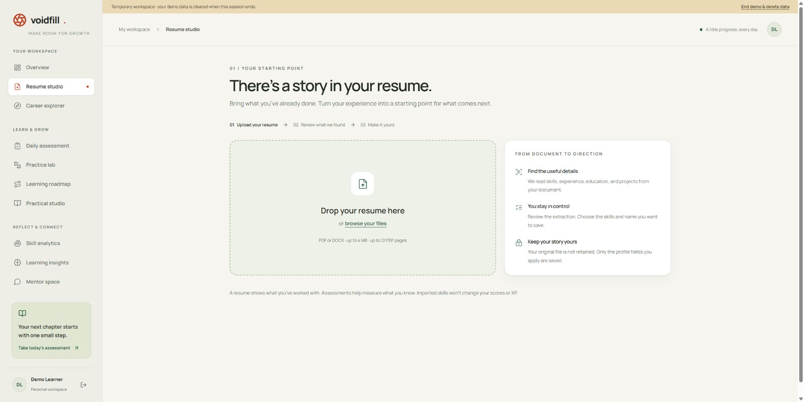

3. **Accounting overview — clear.** The weekly route explains knowledge,
   resources, practical work and feedback in order. Empty states offer a next
   action and XP is explicitly distinguished from job readiness.

   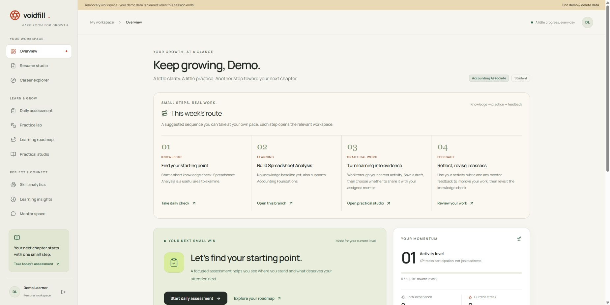

4. **Accounting atlas — usable with a list alternative.** The next branch,
   search, learning-state filter and map/list switch are visible. Unassessed
   knowledge is not presented as failure. The initial empty resource state
   provides resource discovery and assessment actions.

   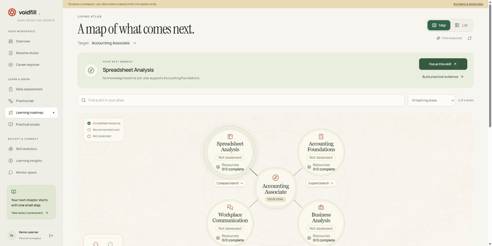

5. **Assessment dialog — keyboard recovery passed.** Initial focus enters the
   dialog; Tab from the last control wraps to Close, Shift+Tab wraps back, and
   Escape restores focus to the assessment launcher. A visible focus outline is
   present. The original answer group had only the generic name “Choose one
   answer,” so question context is improved in this change.

   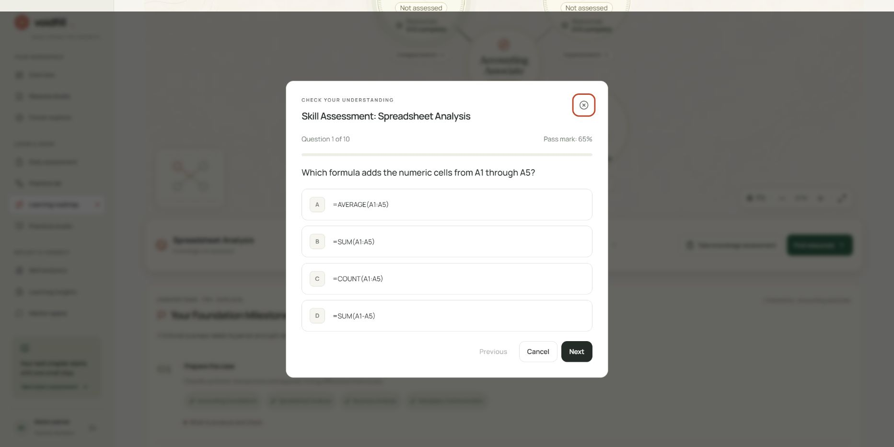

6. **Private practical work — clear privacy boundary, structural fixes needed.**
   The brief, expected work, rubric and private editor are distinct. No mentor is
   silently assigned. The DOM exposed two nested main landmarks; the help/counter
   text also formed part of the changing input name. Small muted text had
   insufficient calculated contrast on its declared light background.

   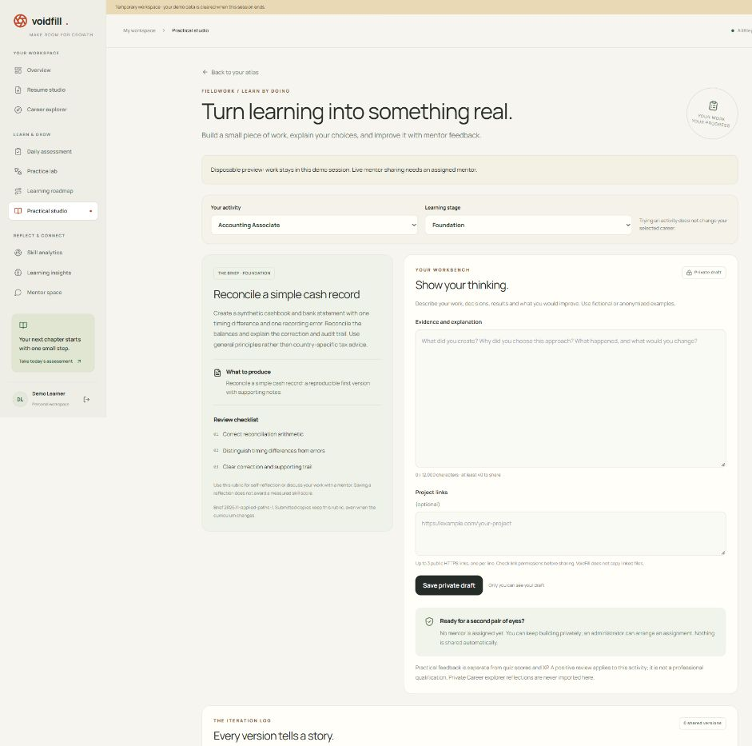

7. **Narrow practical layout — reflows.** The captured view stacks controls and
   keeps a readable heading and form. The browser's existing zoom made the
   requested 355-pixel override render at 323 CSS pixels, so this baseline is
   evidence of that narrower state, not an exact 355-CSS-pixel measurement.

   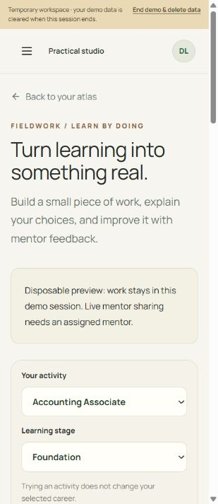

8. **Mobile navigation — visually clear, modal semantics needed.** Opening the
   sidebar moves focus to Close and Escape returns focus to its launcher. The
   original DOM still exposed the sidebar as a complementary landmark and left
   the background workspace active. A named dialog and inert workspace address
   that mismatch.

   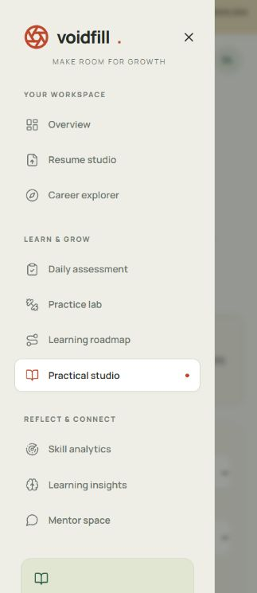

## Changes grounded in these checks

- Remove nested main landmarks from learner Practical Studio and mentor reviews;
  the shared workspace retains the single main destination and skip link.
- Give the open mobile navigation a named modal role and make the workspace
  background inert, preserving focus restoration when it closes.
- Give each workspace its route-specific browser title instead of a repeated
  generic title.
- Separate static practical input names from character counts and link help.
- Darken practical fine print and other small muted text. The original examples
  `#77826e`, `#7b8374`, `#74806f` and `#7a8472` calculated at approximately
  3.87–4.11:1 against `#fffef8`, below the normal-text 4.5:1 target. These are
  declared-color measurements, not a claim about every rendered surface.
- Include the actual question in each answer group's accessible name and expose
  question changes as polite live text. No actual screen-reader output is claimed.
- Keep daily save failures visible. A real acceptance check paused for more than
  the sealed token's two-hour lifetime and could recover only after noticing a
  short-lived toast and reloading. The change explains the actual expiry,
  preserves answers after other save failures, and offers an explicit new check
  for an invalid/expired token. Server grading and expiry rules remain unchanged.

## Final Chrome verification — 8 November 2026

The rebuilt production-mode application was checked through Chrome against
localhost, with the ONNX learning service running. The checks below used fresh
disposable learner and mentor demos. Each accepted JPEG was saved and opened;
clipped full-page captures were rejected and replaced with normal viewport
captures. No real-account or GitHub screenshots are included here.

1. **Private practical work — passed.** The rendered page has one `main`
   landmark and the title `Practical studio · VoidFill`. The evidence field kept
   the name “Evidence and explanation” as its counter changed from 0 to 124;
   project-link instructions and the counter are descriptions, separate from
   the static names. Keyboard focus is visible.

   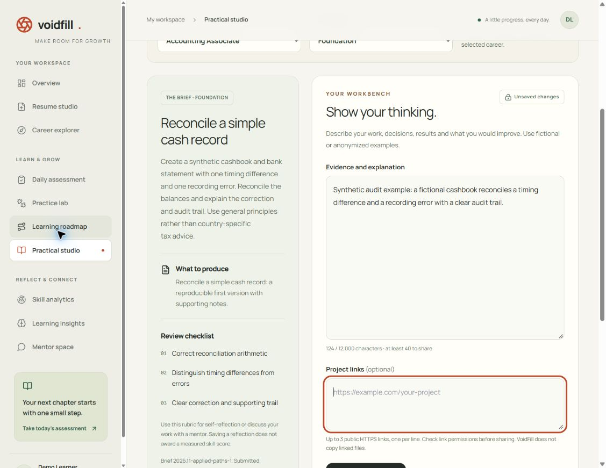

2. **Narrow practical layout — passed at 355 CSS pixels.** The temporary
   390 × 844 browser override, with the user's existing 110% zoom, measured
   355 × 767 CSS pixels. The page and controls stacked, with both the root
   client width and scroll width measuring 355 pixels after layout settled.
   This is evidence for the measured width, not an exact 390-CSS-pixel test.

   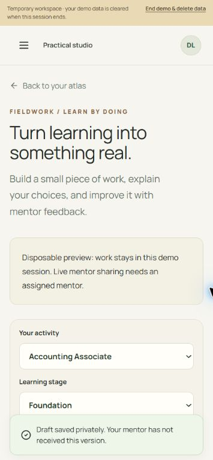

3. **Mobile navigation — passed.** The open menu has the name “Workspace
   navigation,” `role="dialog"` and `aria-modal="true"`; its workspace wrapper
   is inert. Focus initially enters Close. Tab from Sign out wraps to the brand
   link, Shift+Tab wraps back, and Escape restores focus to Open navigation and
   clears inert. The screenshot shows the dimmed background and menu.

   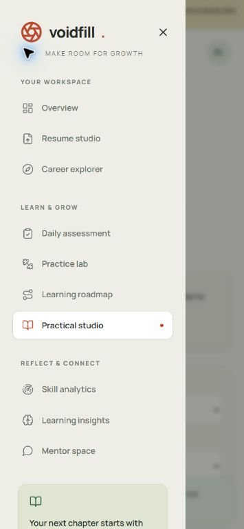

4. **Daily assessment entry — passed.** The route title is `Daily assessment ·
   VoidFill`, and the visible timing text says “No countdown. Open checks expire
   after two hours.”

   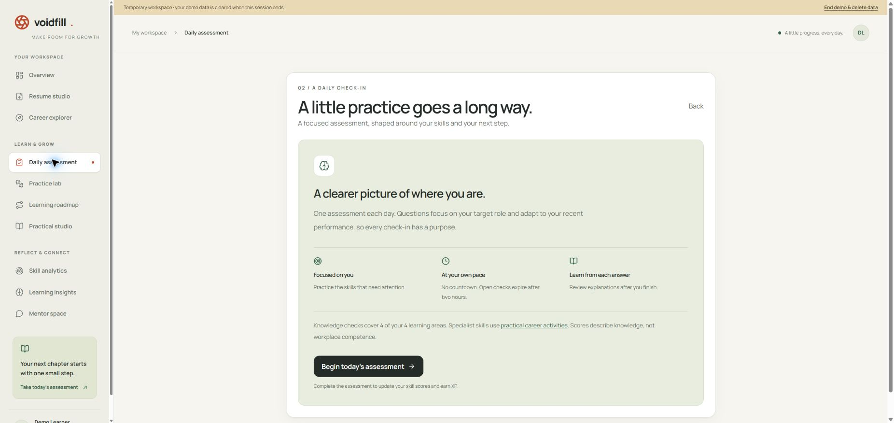

5. **Daily question context — passed.** The answer fieldset's name contains the
   actual question and “Choose one answer.” The visible question has a polite,
   atomic live region. A selected native radio led by Tab to Next with a visible
   focus outline; the next question updated the group name. This checks DOM and
   keyboard behavior, not spoken screen-reader output.

   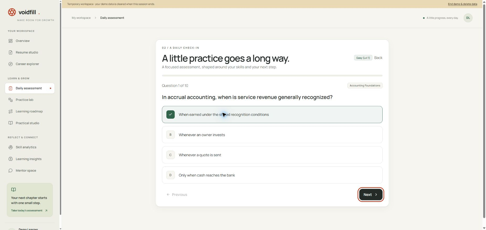

6. **Interrupted daily save — passed.** With only the local web process paused,
   Finish displayed a persistent inline alert explaining that the result was
   unconfirmed and answers remained available for retry. All ten selections
   remained checked when moving backward through every question and forward
   again; the alert remained visible throughout. The network detail still says
   “Failed to fetch,” while the surrounding text supplies the recovery action.

   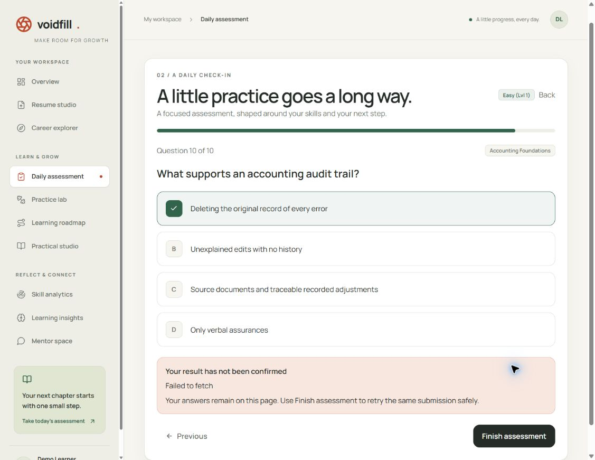

7. **Mentor review desk — passed.** The synthetic shared-work queue rendered
   with one `main` landmark and the title `Practical reviews · VoidFill`.
   Activating Skip to content focused `main-content`. No feedback was sent to a
   real learner.

   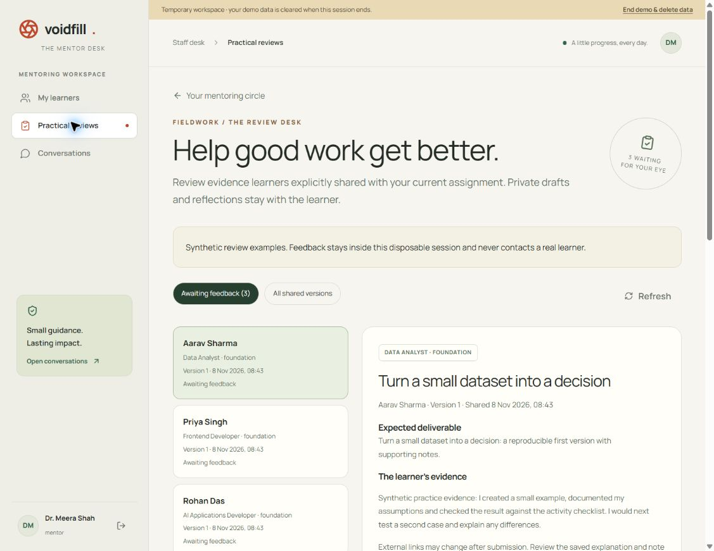

8. **Roadmap assessment dialog — passed.** The actual Python question appears
   in the answer group's name and a polite, atomic live region. Tab from Next
   wraps to Close, Shift+Tab returns to Next, and Escape closes the dialog and
   restores focus to Take knowledge assessment. The browser title is `Learning
   roadmap · VoidFill`.

   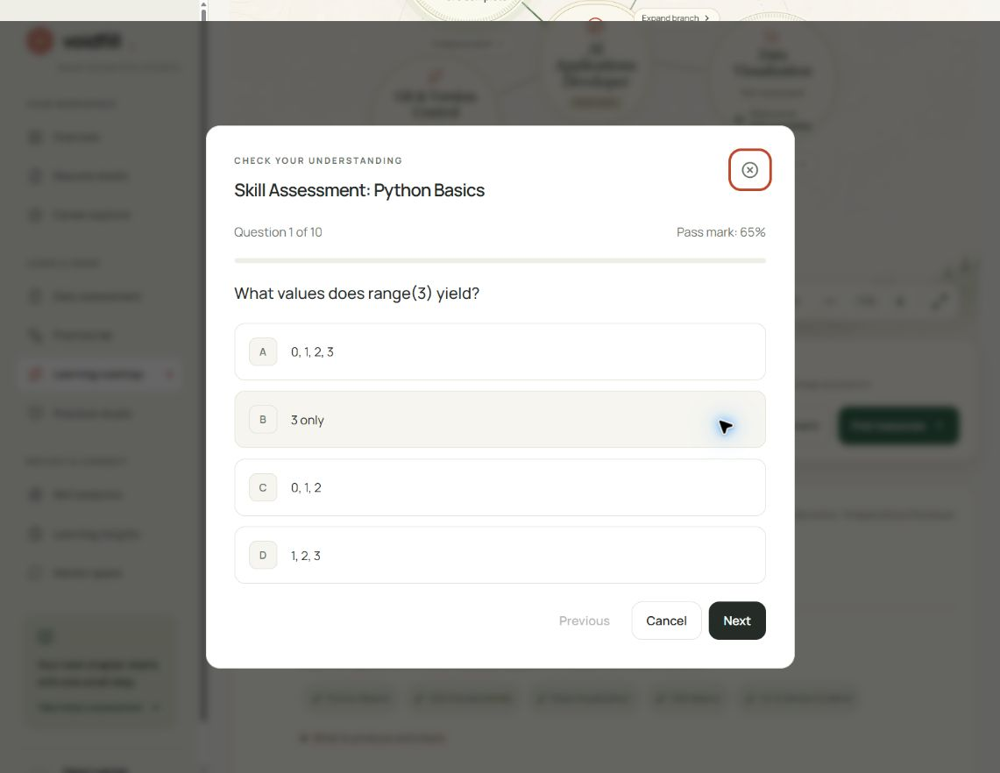

9. **Practice question context — passed.** The practice page has its own
   `Practice lab · VoidFill` title. Its generated question also appears in the
   answer group's name and a polite, atomic live region. The session was left
   without saving a result.

   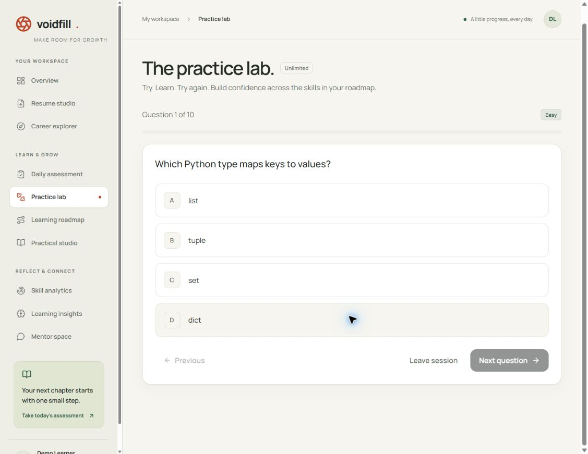

10. **Retry and saved result — passed.** After the web process returned, Finish
    saved the same retained answers without reloading the question page: 2/10,
    60 XP. Reloading then showed that same saved result. A separate dashboard
    reload showed one daily attempt, 60 total XP and a one-day streak.

    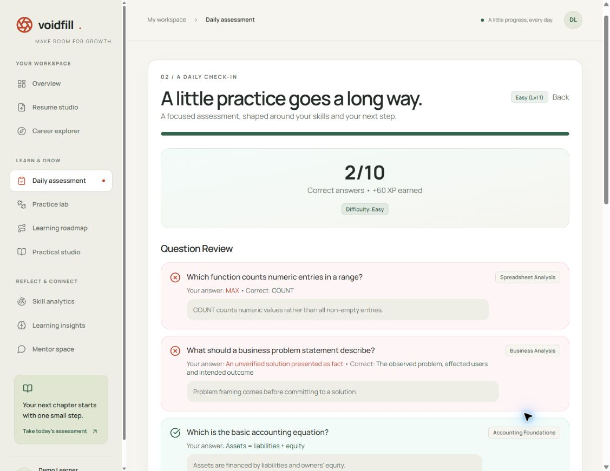

    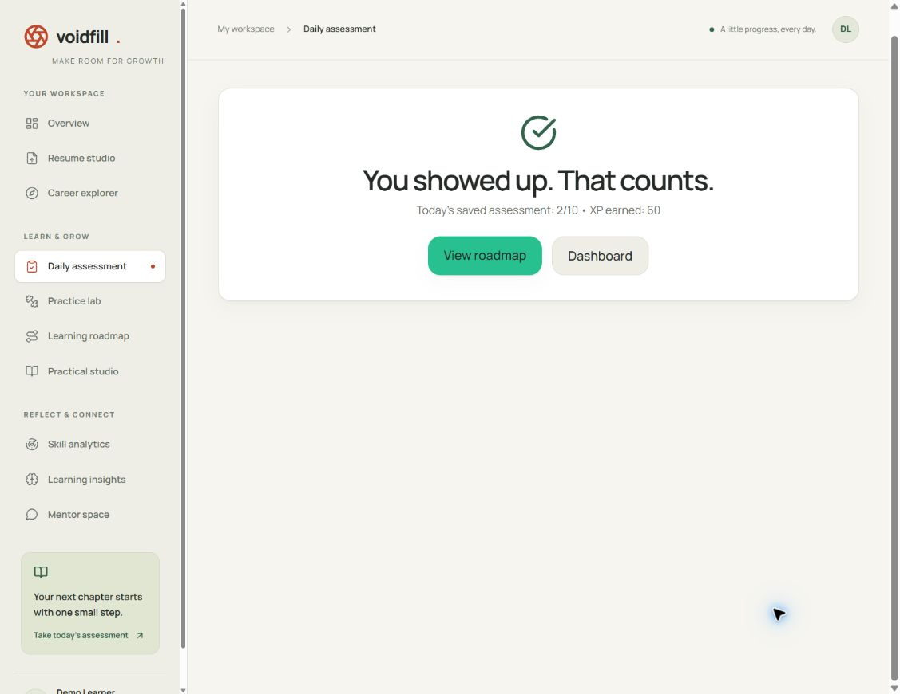

### Remaining evidence limits

The first outage attempt exceeded the disposable demo's approximately one-minute
connection lease, so it returned to the public entry before a retry could be
verified. The successful repeat kept the same demo alive through an ordinary
dashboard tab on a second local port serving the same build. Its normal UI
heartbeat preserved the test fixture while the first web process was paused;
no cookies, tokens or browser state were copied or injected. This tests local
network-failure recovery, not a production outage or measured live capacity.

The two-hour invalid/expired-token branch and its Start a new assessment action
were reviewed in source but were not exercised by waiting two hours in Chrome.
The browser check verifies the visible expiry guidance, generic error persistence,
answer retention and successful retry. In that release, hard refresh discarded an
unfinished question page, so the guidance asked learners to retry on that page.
The 8 November follow-up implements authenticated same-tab recovery for daily,
practice, course and skill checks. Actual Chrome reloads retained the question
position and selected answers for all four; a recovered synthetic daily check
saved 10/10 and 100 XP, and reload retained that result. See
[assessment recovery](ASSESSMENT_RECOVERY.md) and the follow-up release evidence.

The inspected practical colors now calculate at approximately 4.84:1 for
`#606d59` on the brief's `#eff2e8`, 5.43:1 for that text on `#fffef8`, and 5.40:1
for `#616d5b` help text on `#fffef8`. Chrome's computed text colors matched these
declarations. These sampled measurements do not establish contrast compliance
for every surface or state.

No Playwright CLI suite, axe injection, human participant study or screen-reader
speech session was run. The temporary viewport override was reset. Disposable
mentor and learner demos were ended through their normal UI; the auxiliary tab
then returned to login and was closed. No source fixes were needed during this
final Chrome pass.

## Hosted preview smoke — 8 November 2026

Chrome also checked the ready Vercel preview for application commit
`509f466375a6149c8bc34adb91ad4492adce1623` at
[the release preview](https://void-fill-dcr2qa2ai-zsw0rds-projects.vercel.app).
This was a brief deployment smoke check, separate from the deeper local checks
above. No new authentication challenge was required.

1. **Private demo entry — passed.** The existing private entry opened and a fresh
   synthetic AI Applications Developer learner workspace was created.
2. **Hosted question generation — passed.** Begin today's assessment returned a
   real generated quiz showing Question 1 of 10 and selectable answers. This
   confirms that the preview can reach its configured learning service; it does
   not identify that service's model build or prove capacity. No result was
   submitted. The sampled source question contains the spelling error
   “proprtions,” a content-quality observation rather than a functional failure.
3. **Practical route — passed.** The heading loaded, the browser title was
   `Practical studio · VoidFill`, and the rendered page had one `main` landmark.
4. **Demo cleanup — passed.** End demo & delete data returned to the public
   `/?demo=ended` entry; the demo-ending control was absent afterward.

The following exact Chrome screenshot was saved, opened and accepted. It uses
only the disposable synthetic learner and contains no private entry key,
credentials or real-account details. The main production college account was
not accessed during this preview check.

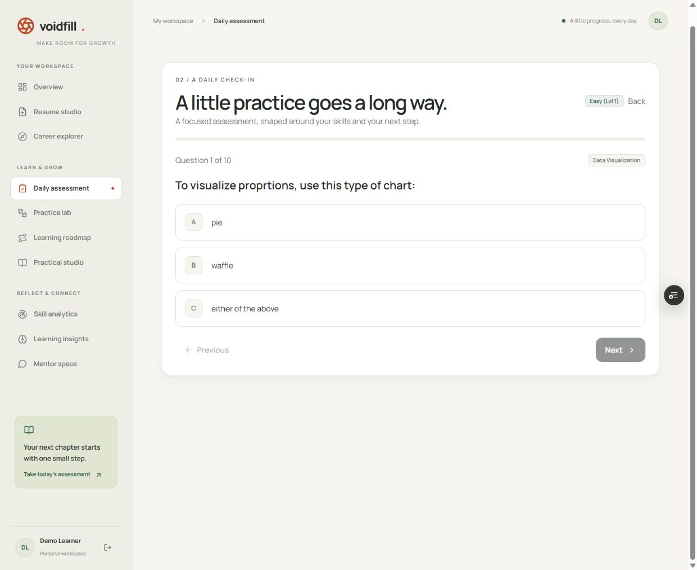
