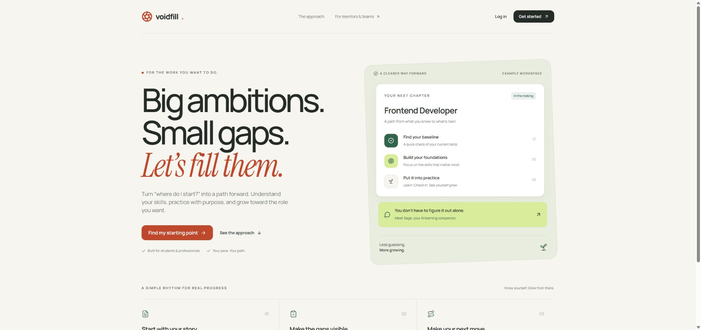
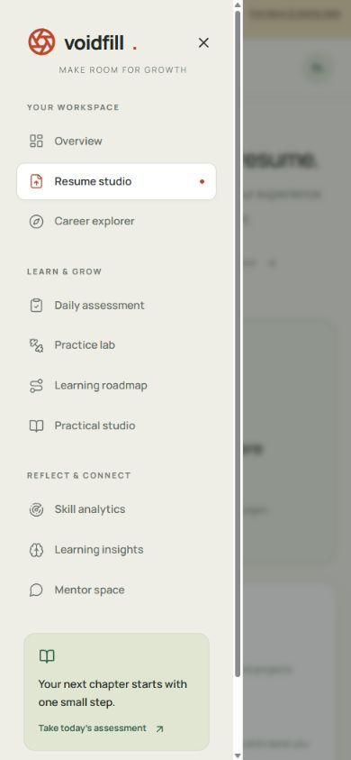
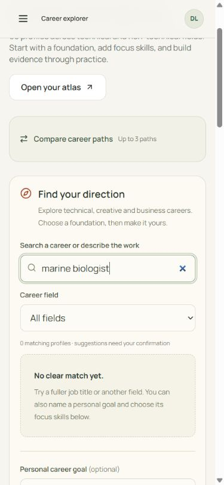
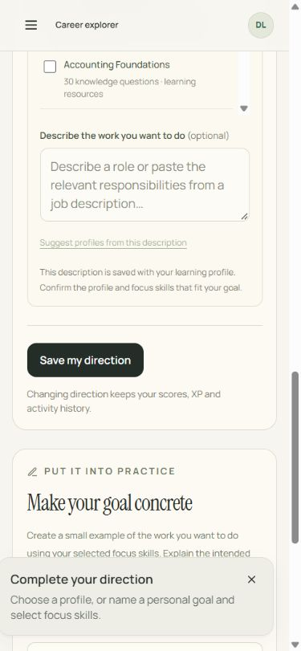
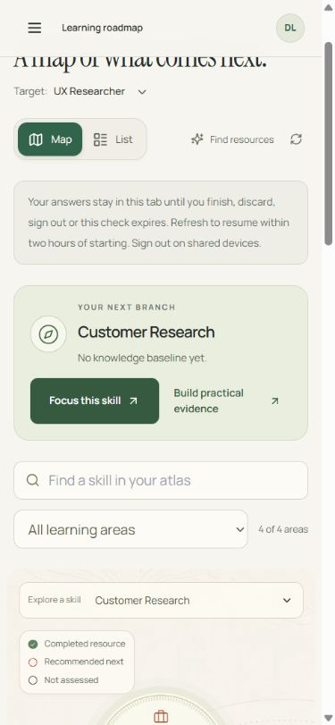
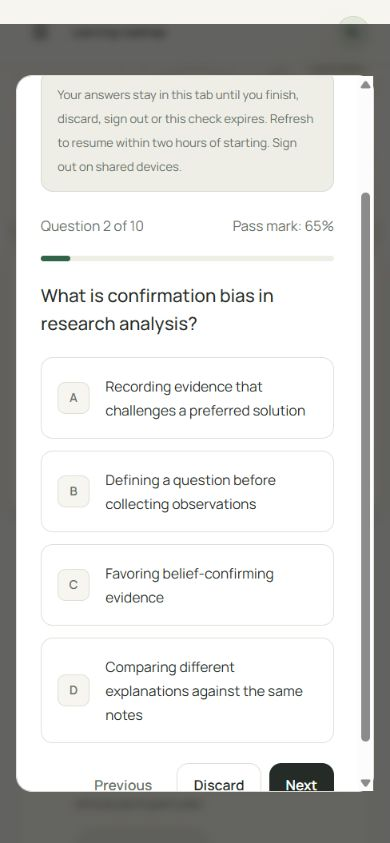
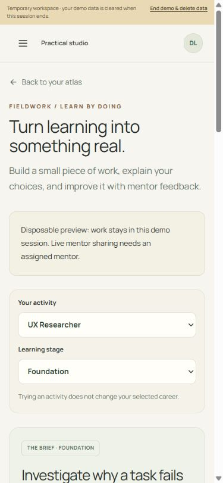
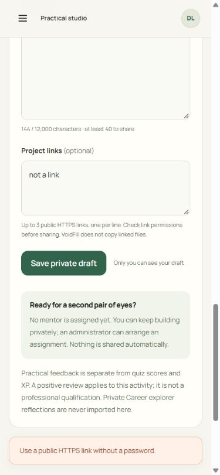

# Chrome learner-flow UX and accessibility review

This is the continuing audit for the model/performance/career-path release.
The baseline screenshots below were captured in Chrome on 8 November against
production source `50cc8a0`, then reopened and inspected from their saved files.
They show fictional disposable workspaces, not real learner records.

Implementation state on 9 November: the repairs below are in source. Focused
practical/link tests, TypeScript and lint passed. **Post-repair rendered Chrome
verification is still pending:** the current browser tool reports that local
browser use is disabled in Work settings. Baseline screenshots and source review
do not prove that the repaired version behaves correctly in the browser.

No Playwright CLI/MCP or axe suite was run. This report does not establish WCAG
compliance, screen-reader speech behavior, participant usability outcomes or
professional career readiness.

## Numbered walkthrough and findings

| Step | Learner task | Baseline health and evidence | Repair and remaining verification |
| --- | --- | --- | --- |
| 1 | Enter from the public landing page | Healthy visual hierarchy: the starting-point action and example workspace are distinct. Desktop evidence `baseline-01`; phone entry was also captured in the private audit record. | No new landing redesign. Recheck normal entry in the candidate release. |
| 2 | Open, close and navigate with the mobile menu | The menu has a clear current page and close control (`baseline-04`). The earlier interaction check found that Escape returned to the menu trigger, but a route change could leave focus on the document body. | Route-arrival focus now waits until menu cleanup removes `inert`, then moves from navigation to the new main landmark. Closing without navigation preserves the trigger. Desktop sidebar arrival is included. Needs keyboard verification after rebuild. |
| 3 | Search for a career and understand an unmatched title | Healthy coverage boundary: an unsupported marine-biologist query shows no clear match and explains personal goals instead of inventing a curriculum (`baseline-06`). Some secondary copy used light colors at small sizes. | Darker secondary copy and explicit focus rings preserve the existing cream/sage design. Source color changes still need computed-style and visual checks on the candidate. |
| 4 | Save a personal goal with missing focus skills | Needs repair: the baseline gives a generic transient toast near the Save button while the required skill chooser is above it (`baseline-07`). | A persistent field-associated error now identifies the exact missing field, opens the personal focus section and focuses the relevant input/group. Repeated invalid attempts can re-focus it. Saving also locks compare controls so a pending response cannot describe a different previewed career. Needs actual invalid-save and save-in-flight checks. |
| 5 | Find a next step in the atlas | The phone atlas exposes map/list views, a suggested next branch and a skill filter without requiring a pointer (`baseline-08`). | Existing behavior retained. Discarding a paused draft now returns focus to the atlas heading rather than removing the focused control and leaving focus on body. Verify both direct discard and notice discard. |
| 6 | Move through and pause an assessment | The displayed question, answer group, progress and Previous/Next controls are distinct (`baseline-09`). The earlier interaction/source check found polite question-change announcements, so those were retained. | Retest selection, next/previous, close/resume, refresh and paused-draft discard with the new navigation focus behavior. No real grade submission is needed for this regression. |
| 7 | Save practical work and correct an invalid link | The case/editor distinction and private-draft message are clear on phone (`baseline-10`). Needs repair: an invalid link produces a general error below the sharing area with no field association (`baseline-11`). | Client/server URL rules now share one small normalizer; a bad list is rejected before saving, keeps the draft intact, marks the links field invalid and focuses it. Save/error feedback sits near Save and receives focus. Pending writes lock editable fields/activity changes and use an immediate ref guard. Dirty activity changes focus the save guidance. Verify error, successful save, refresh persistence and edit-after-save status. |
| 8 | Understand the task shared with a mentor | Baseline source showed the mentor view displayed case inputs/deliverable but omitted the saved task instructions. This step has no accepted rendered baseline screenshot. | Mentor review now displays the frozen assigned task as well as inputs, deliverable and rubric. Learner and mentor views optionally show safe concept-reference links, explicitly described as background rather than endorsement. A disposable staff/mentor Chrome check is still required. |

## Baseline screenshot sequence

These are **before-repair** evidence. They must not be presented as proof of the
candidate release or as a completed post-repair accessibility audit.

## Candidate acceptance checklist

- At narrow phone width, one main landmark and no horizontal document overflow.
- Escape closes the mobile menu and returns to its trigger; choosing a route
  focuses that route's main landmark after the menu is closed.
- A missing goal/focus error remains visible, references the correct field and
  focuses it. A later valid edit clears stale feedback.
- A pending direction save disables career-compare changes as well as the picker.
- Closing/resuming and refreshing a synthetic assessment retains its selected
  answers. Discard removes the draft and returns focus to the atlas heading.
- An invalid practical link is rejected before the save request and focuses the
  links field; valid private save focuses its confirmation and survives reload.
- Evidence/links/activity controls cannot change while a practical write is
  pending. Editing after a successful save removes the stale success notice.
- New case instructions, inputs, expected deliverable and checks are visible in
  learner and mentor views; saved older briefs keep their original content.
- Temporary demos are ended through normal controls and viewport overrides reset.

Actual screen-reader output, low-vision user preferences, motion sensitivity and
human task comprehension need participant testing using the
[prepared learner protocol](LEARNER_PILOT.md). Browser semantic checks and source
attributes are engineering evidence only.
