# Chrome learner-flow UX and accessibility review

This is the pre-publication evidence snapshot. The final source, hosted preview,
production deployment and subsequent Chrome/performance acceptance are recorded
in the [release record for PR 11](https://github.com/Zsw0rd/VoidFill/pull/11).
Later hosted results do not relabel these earlier screenshots as live evidence.

## Evidence and scope

On 9 November, Chrome **Person 1** was used through the supported CUA browser
controls. No Playwright CLI/MCP, axe suite, alternate browser or injected
application/network state was used. Every candidate JPEG was saved immediately,
reopened and visually inspected. Rejected transitional frames were replaced
before accepting evidence.

The hosted candidate reviewed was deployment
`void-fill-1qr5pqd6k-zsw0rds-projects.vercel.app`, source
`efaf42a6b64c7805027d31aef53b1faed3cbb3b8`. It was reached through the owner's
normal Chrome access; protection settings were not changed. This run used only
fictional, disposable learner and mentor demos. No real account records, grades,
mentor messages, profiles or access settings were changed.

**Preview result:** the repaired career and practical forms, real pending-save
locks, route-arrival focus, mobile menu, assessment recovery and mentor task
presentation were observed working. The run found a further question-navigation
focus defect across all four assessment purposes, plus an unrelated course
question relevance defect. The focus repair passed the rebuilt local Chrome
keyboard checks for daily, practice, skill and course assessments. The rebuilt
course flow now keeps unavailable-check guidance visible and offers a working
broader-skill action; a supported lesson opens its seven linked questions. Final
hosted verification is still pending.

Viewport override: 390 × 844 CSS pixels (375-pixel document content width with
Chrome's scrollbar). The checked learner entry had one main landmark and
`scrollWidth === clientWidth === 375`. This is a narrow-width engineering check,
not evidence for every device, zoom level or assistive technology.

## Numbered walkthrough and findings

| Step | Learner task | Current health and accepted evidence | Observed behavior and limits |
| --- | --- | --- | --- |
| 1 | Enter from the public landing page | Healthy visual hierarchy. `candidate-01`, `candidate-02`. | Public starting-point action and illustrative workspace are distinct. Temporary learner entry focuses main content. Both desktop landing and narrow learner entry were captured. |
| 2 | Open, close and navigate with the mobile menu | Healthy in the checked flow. `candidate-03`. | Menu opening focuses Close navigation. Escape closes it and returns focus to Open navigation. Choosing Career explorer closes the menu and focuses the new main landmark. |
| 3 | Search for a career and understand an unmatched title | Healthy coverage boundary. `candidate-04`. | “marine biologist” returns zero matches, says “No clear match yet” and explains personal goals. The current source exposes 60 profiles. This does not establish curriculum quality for all 60. |
| 4 | Save a personal goal with missing fields | Repaired behavior observed. `candidate-05`, `candidate-06`, `candidate-07`. | Missing name produces persistent field-associated text and focuses the required input; `aria-invalid=true` and `aria-describedby` identify its error. Missing skills reopens a deliberately collapsed chooser, focuses its group and associates the error. Edits clear stale errors. A real pending save disabled the picker and compare add/remove/preview controls. The success status received focus. |
| 5 | Find a next step in the atlas | Healthy in the checked flow. `candidate-08`, `candidate-13`. | The saved personal direction and chosen focus skill appear in the atlas. Map/list, skill search/filter and next-branch controls are exposed. Discarding a paused assessment removed the draft and focused the atlas h1. |
| 6 | Move through, pause and recover an assessment | Recovery and repaired keyboard focus passed. `candidate-09`–`candidate-13`, `final-27`–`final-31`. | Skill question selections survived Next/Previous, close/resume and browser refresh. Close returned focus to Resume; paused discard returned it to the atlas h1. The preview exposed body focus after Next/Previous disabled their triggering control. In the rebuilt local app, keyboard Next and Previous focused the rendered question for daily, practice, skill and course checks, with selected answers retained. Answer selection kept radio focus. Daily/practice discard focused the entry h1; direct skill discard focused the atlas h1. Original polite/atomic announcements remain. No grade was submitted. |
| 7 | Save practical work and correct an invalid link | Repaired behavior observed. `candidate-14`–`candidate-19`, `final-32`. | An HTTP link was rejected locally with an associated error; the links textarea gained `aria-invalid=true` and focus while retaining evidence. Attempting a dirty stage change kept Foundation and focused Save guidance. During a real save, evidence, links, activity and stage were disabled and the editor reported busy. Success focused its nearby private-save status. After refresh, reselecting Accounting restored the exact saved evidence/link. A later edit removed the stale success notice. The rebuilt v4 Accounting checklist separately checks the two calculations and each item's period, evidence and authorized correction. No mentor sharing occurred. |
| 8 | Understand the task shared with a mentor | Repaired presentation observed, including v4. `candidate-21`, `candidate-22`, `final-33`, `final-34`. | The disposable review queue displayed Assigned task, frozen instructions, synthetic inputs, expected deliverable, evidence and saved rubric/version. Expanded concept references included the background/nonendorsement note and safe new-tab links. A new v4 mentor session displayed the Data Analyst case with its v4 saved version. No feedback was submitted. Browser evidence does not cover migration of an old persisted brief across a curriculum deployment. |

## Additional defect found during the walkthrough

The course entry **Python Basics → Python data structures** described lists,
sets, dictionaries and comprehensions, but its first generated check asked
“Which of these problems is a Regression analysis-based problem?” The next asked
which variable is numeric. The popup was correctly titled **Assessment: Python
data structures**. This is a content relevance problem, separate from the focus
repair. Evidence: `candidate-25-preview-course-question-relevance.jpg`.

The rebuilt local repair rejected that unavailable course bank with a persistent,
focused in-dialog alert. “Check the broader skill” opened **Skill Assessment:
Python Basics** and focused its first prompt; the old course error was cleared.
“Back to your atlas” returned focus to the atlas h1. **Python control flow**
opened seven resource-linked questions, without filling the remaining requested
slots with unrelated questions. Keyboard Next/Previous focused each prompt,
retained the first answer and kept radio focus during answer selection.

No course or skill grade was submitted. The backend also has independent
eligibility checks; this browser sample does not certify every question's
editorial relevance or every resource mapping.

Final preview gate: the unavailable pane now suppresses the assessment-recovery
notice, because no assessment token or selected answers exist at that point.
The local `final-35` frame predates that final copy correction. Its behavior is
verified; the corrected pane still needs hosted visual confirmation.

## Accepted candidate screenshots

### 1. Entry

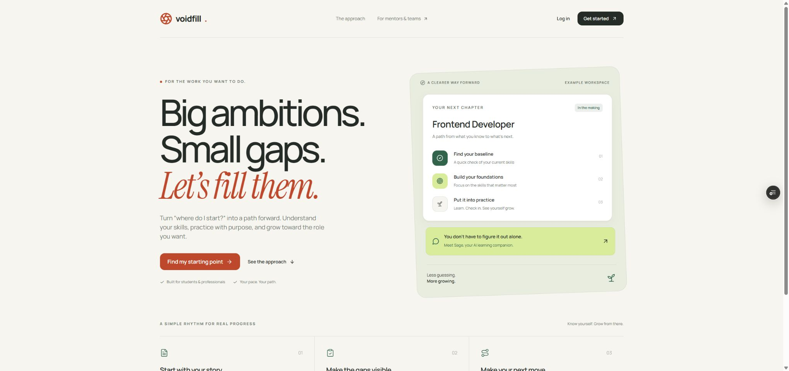

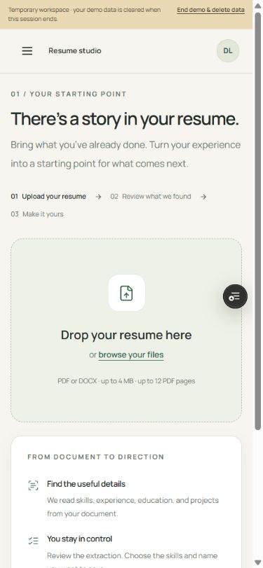

### 2. Mobile navigation

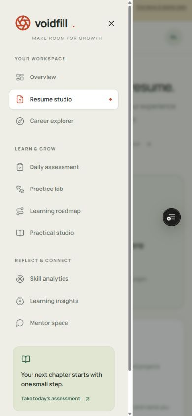

### 3. Career coverage boundary

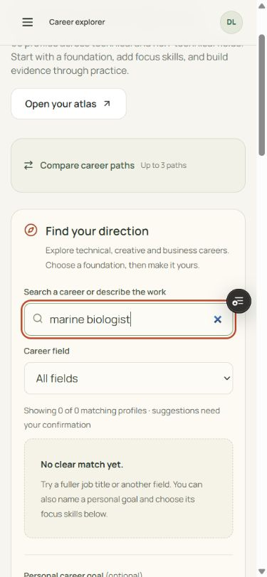

### 4. Personal-goal validation

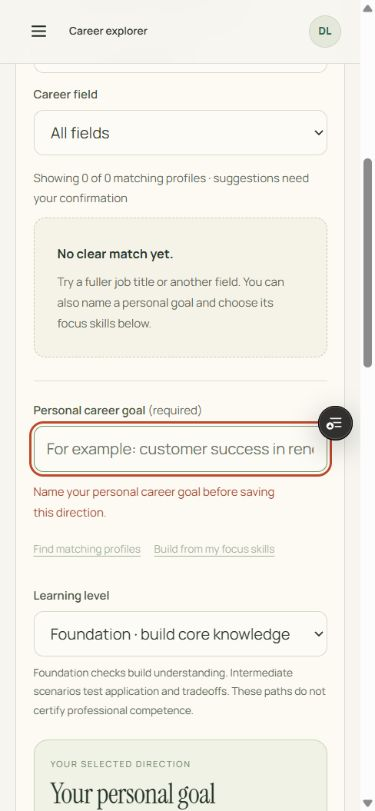

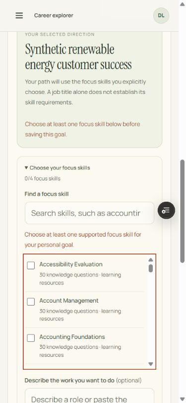

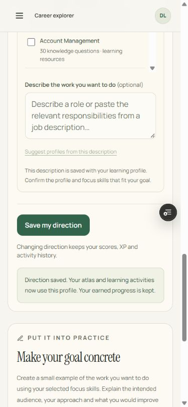

### 5. Atlas

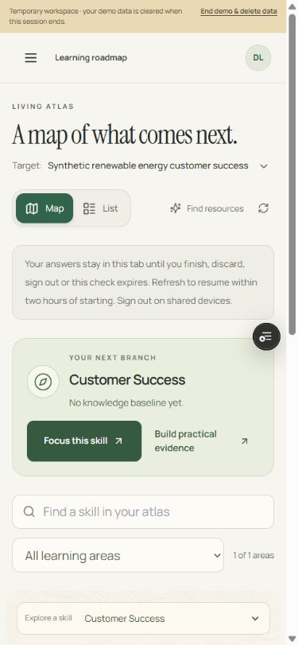

### 6. Assessment recovery and focus finding

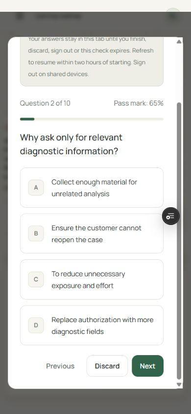

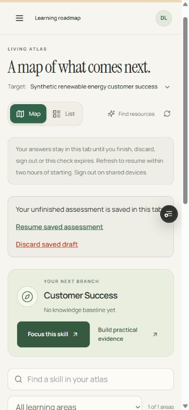

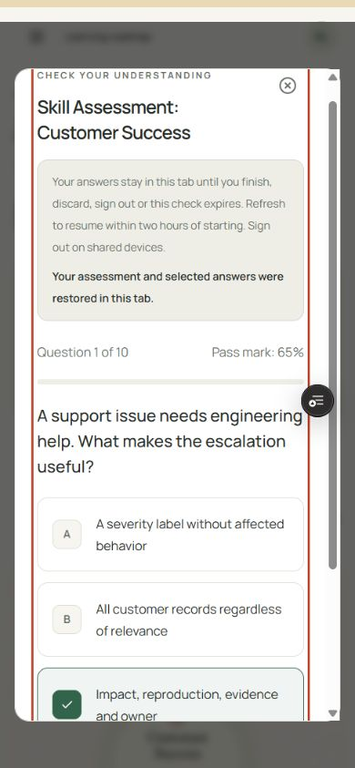

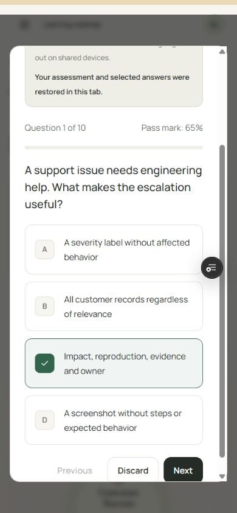

### 7. Practical case, validation and private save

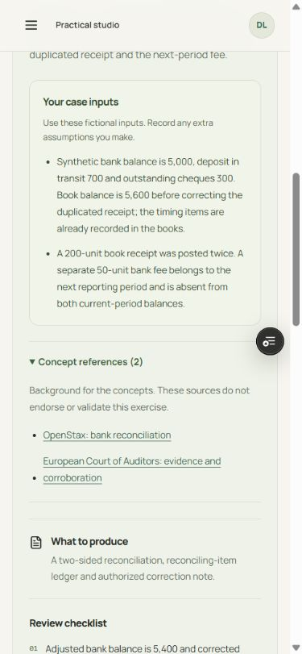

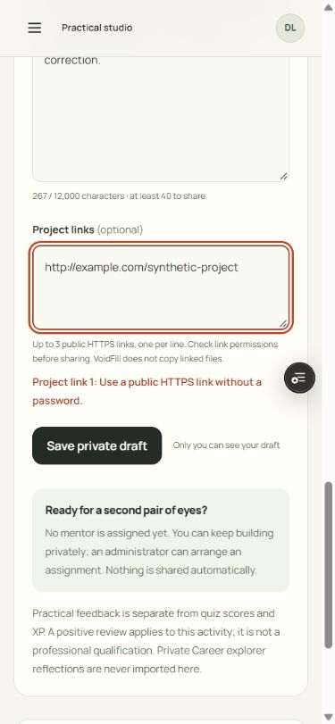

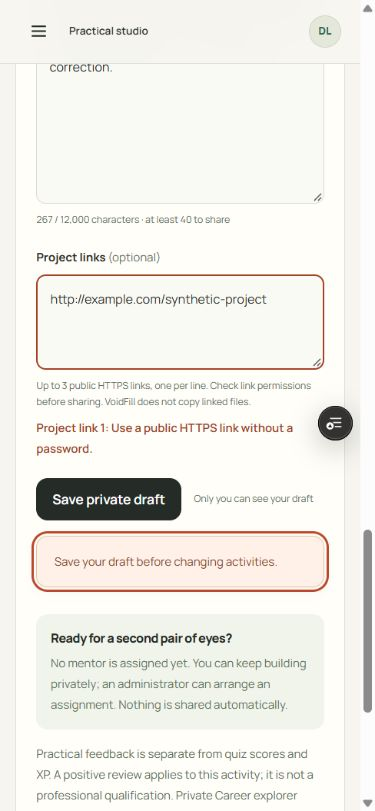

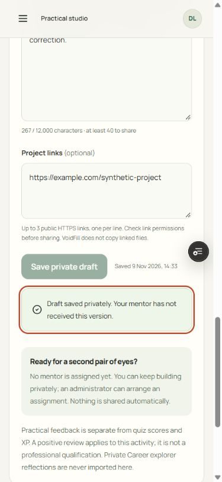

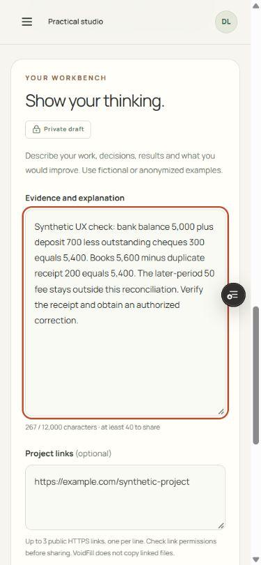

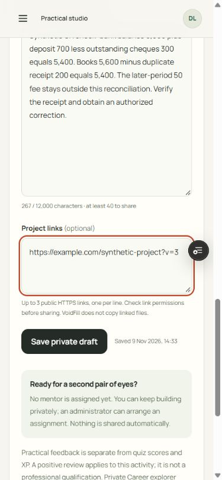

### 8. Mentor task and frozen case context

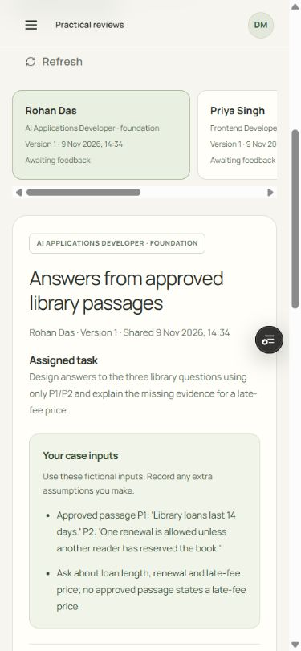

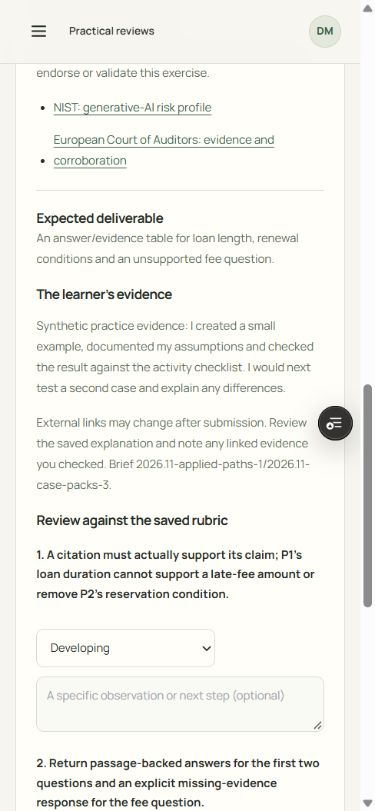

### Supporting evidence

- [Paused-draft discard state](assets/ux-accessibility-20261109/candidate-13-preview-discard-focus.jpg).
- [Demo ended through its normal control](assets/ux-accessibility-20261109/candidate-20-preview-demo-ended.jpg).
- [Practice focus defect](assets/ux-accessibility-20261109/candidate-23-preview-practice-focus-defect.jpg).
- [Daily focus defect](assets/ux-accessibility-20261109/candidate-24-preview-daily-focus-defect.jpg).
- [Course question relevance defect](assets/ux-accessibility-20261109/candidate-25-preview-course-question-relevance.jpg).
- [Course focus defect](assets/ux-accessibility-20261109/candidate-26-preview-course-focus-defect.jpg).

## Rebuilt local keyboard verification

The rebuilt local candidate included the shared question-navigation focus repair
and case-pack v4. It was served from the configured `localhost` origin. Keyboard
Enter was used on Next, Previous and Discard. These are distinct from the hosted
preview frames above, which show the defects before this final repair.

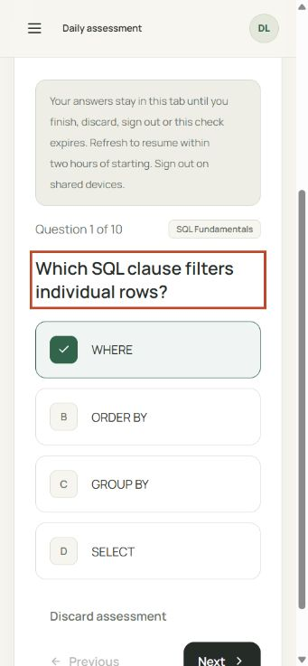

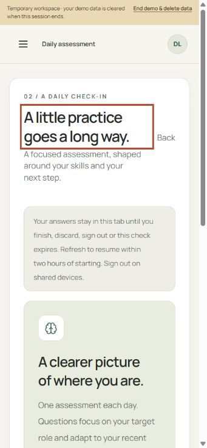

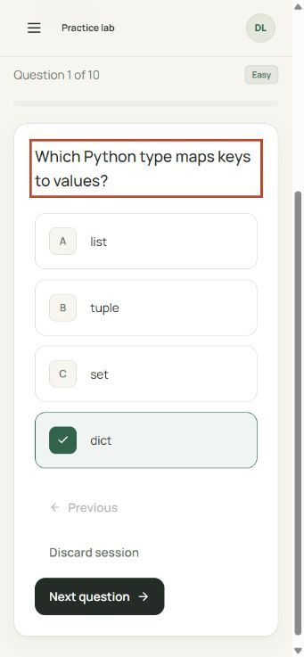

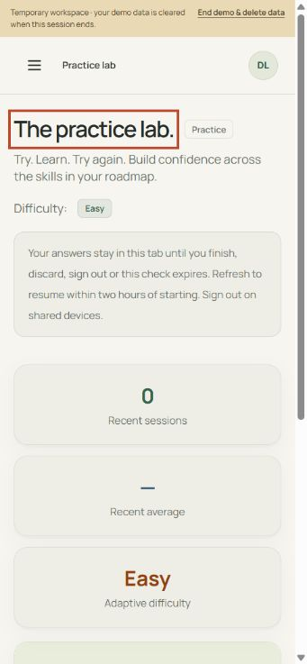

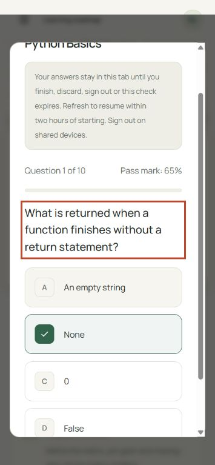

An initial course screenshot was rejected after an interruption changed the
page to the ended-demo landing screen. The fresh supported-course frames below
replace it. Transient-toast captures that did not show the message were also
rejected and removed.

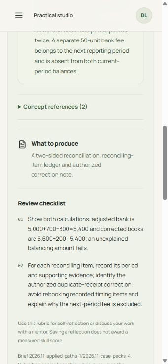

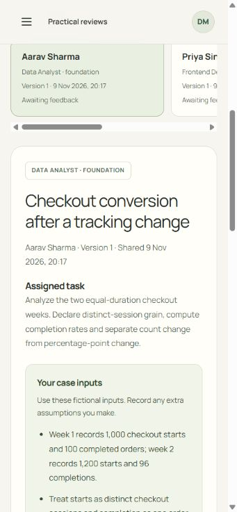

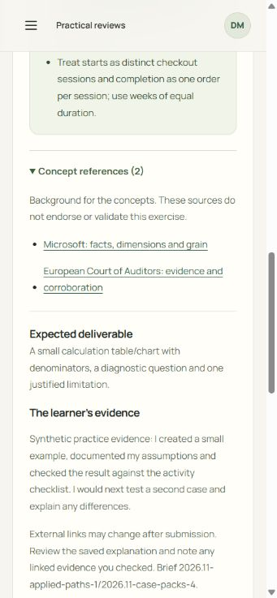

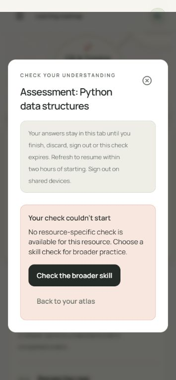

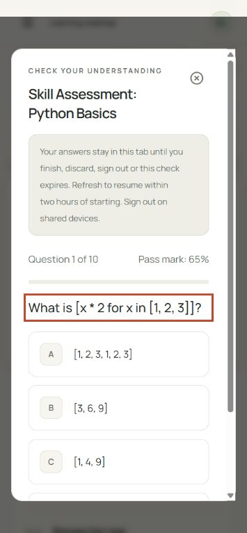

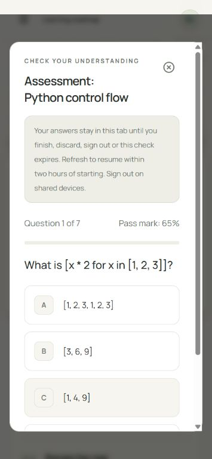

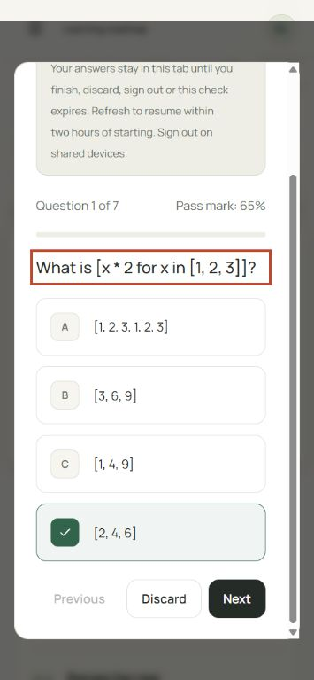

## Baseline separation

Files named `baseline-*` in the same asset folder are the earlier 8 November
before-repair evidence from production source `50cc8a0`. They are retained for
comparison and are not evidence for this candidate. Current-run files are named
`candidate-*`. Rebuilt-source evidence is named `final-*`.

## Limits and cleanup

The initial learner and mentor sessions reached the public `?demo=ended` page
through **End demo & delete data**. The ungraded daily/practice/course session
was also ended through that control, with arrival verified. The local keyboard
test session was observed at the ended-demo landing screen after interruption.
The later v4 learner, mentor and course-guidance sessions were all ended through
the normal control and arrival was verified. Final hosted checks and viewport
reset remain before handoff.

Screenshots and semantic DOM checks do not establish WCAG compliance, actual
screen-reader speech, low-vision preference behavior, motion sensitivity,
participant usability outcomes or professional career readiness. Those require
additional testing using the [prepared learner protocol](LEARNER_PILOT.md).
